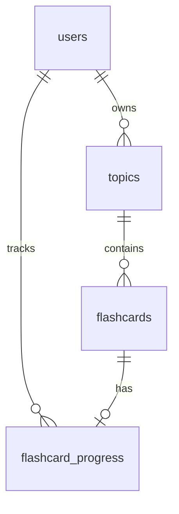

# Database v1

Schema thực thi: `database/schema.sql` (SQLite). Đây là nền tảng cho backend bộ thẻ cá nhân;
UI hiện vẫn dùng localStorage, chưa có API, đăng nhập hoặc đồng bộ database.
Schema không tạo tài khoản, chủ đề hay flashcard mẫu. Ngữ pháp vẫn là nội dung tĩnh riêng.



| Bảng | Dữ liệu chính | Ràng buộc |
| --- | --- | --- |
| users | ID, auth_subject tùy chọn, tên, email tùy chọn | Email duy nhất, không phân biệt hoa/thường ASCII |
| topics | ID, owner_id, tên, name_key | Tên duy nhất trong cùng người học |
| flashcards | ID, owner_id, topic_id, từ, nghĩa, mạo từ, số nhiều, ví dụ, bản dịch | Phải thuộc chủ đề của chính người học |
| flashcard_progress | owner_id, flashcard_id, trạng thái, thời gian | Một trạng thái cho mỗi thẻ; người khác không thể gắn trạng thái vào thẻ riêng này |

`known` và `review` tương ứng đã nhớ/cần ôn; không có dòng tiến độ nghĩa là chưa học.
Khóa ngoại ghép `(topic_id, owner_id)` và `(flashcard_id, owner_id)` ngăn liên kết sai chủ sở hữu.
Xóa chủ đề sẽ xóa thẻ và tiến độ liên quan; xóa người học sẽ xóa dữ liệu cá nhân của họ.
Đây là ràng buộc liên kết, chưa phải phân quyền truy vấn: API vẫn phải xác thực phiên và
lọc mọi thao tác bằng owner_id lấy từ phiên, không tin owner_id do client gửi.

## Khởi tạo và kiểm tra

```sh
npm run db:init
npm test
```

Trên PowerShell có thể dùng `npm.cmd`. Lệnh khởi tạo tạo `data/deutsch-quest.sqlite`,
đánh dấu `PRAGMA user_version = 1`, không ghi đè dữ liệu khi chạy lại.
Thư mục `data/` được gitignore. Chỉ schema/script/test được commit.
Các test database chạy SQLite thật trong bộ nhớ, gồm dữ liệu hợp lệ, chủ đề trùng,
thẻ mồ côi, liên kết khác chủ sở hữu, mạo từ sai và xóa liên đới.
Phiên bản schema tiếp theo cần migration có transaction và tăng user_version;
chỉnh schema.sql không tự nâng cấp một file database v1 đã tồn tại.

## Hợp đồng cho API tiếp theo

- Dùng ID ổn định: giữ nguyên ID chủ đề và `custom-UUID` của thẻ khi nhập từ localStorage.
- Chuẩn hóa tên và tạo `name_key = name.trim().normalize('NFC').toLocaleLowerCase('vi')`.
  Không dùng riêng SQLite lower() để chuẩn hóa tên tiếng Việt.
- Tách mạo từ khỏi từ, chuyển chuỗi tùy chọn rỗng thành NULL; ví dụ/bản dịch có thể rỗng.
- Mỗi connection bật `PRAGMA foreign_keys = ON` trước transaction. Mọi câu lệnh nhận
  dữ liệu người dùng phải dùng tham số bind.
- UPDATE phải đặt `updated_at` theo giờ UTC của server; schema chỉ cấp thời gian mặc định khi INSERT.
- Nhập chủ đề → thẻ → tiến độ trong một transaction, sau khi xác thực người học và validate dữ liệu.
  Không xóa localStorage trước khi import thành công; lịch sử bài tập/ngữ pháp chưa thuộc schema v1 này.
- Không lưu file SQLite cục bộ trên hosting có filesystem tạm thời nếu cần giữ dữ liệu lâu dài;
  bước triển khai phải chọn storage bền vững và cơ chế backup phù hợp.

Tài liệu đối chiếu: [Node.js SQLite](https://nodejs.org/api/sqlite.html),
[SQLite foreign keys](https://www.sqlite.org/foreignkeys.html).
